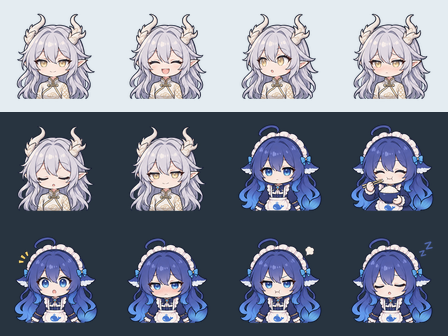

# 云澜 · 白雾 — DSH 主题

给 DeepSeek Harness Web UI 的雾蓝主题插件，附带输入框旁的双角色动画。[DeepSeek Harness](https://www.deepseek.com/harness/)



v0.4.1 把两只角色统一成同一套 Q 版画风。云澜保留银白长发、龙角、金瞳和白金衣装。大肥鱼保留蓝紫长发、鲸尾和鲸鱼围裙，闲置时会端碗用筷子吃白饭。

[角色多视图和透明表情包](docs/character-design/) · [浅色界面](docs/preview-light.png) · [深色界面](docs/preview-dark.png)

## 主题效果

- **底纹内嵌**：白龙淡底纹 + 四层径向雾气，作为对话区 `[class*="viewArea"]` 的 `background-image`，随 52s 动画流动。不遮挡任何内容、不拦截指针。
- **主色 #5C7E92**：素白 / 雾蓝灰，按钮、焦点、选中态统一走 WorkBuddy 那套色。
- **Q 版挂件**：云澜和大肥鱼一起待在输入框右上角，闲置时可以点击任一角色互动。
- **明暗跟随**：官方浅色/深色/跟随系统照常有效。


## 双角色动画

两个 Q 版角色常驻输入框右上角，会根据当前状态自己表演：

| 状态 | 云澜（小龙） | 大肥鱼 |
| --- | --- | --- |
| 闲置 | 打盹 | 捧碗吃白饭 |
| 你在输入 | 凑近注视 | 放下碗偷看 |
| 发送或生成中 | 安静等待 | 稍后露出害羞表情 |
| 偶发互动（闲置 14–22s） | 伸手戳大肥鱼 | 惊跳 → 鼓腮「我不是大肥鱼……」 |

故事设定：**大肥鱼总惦记她的白饭，小龙看不下去就去催她**。

插件通过当前输入框内的草稿、中文输入法组合状态以及发送和停止按钮感知状态。开始输入或生成时会结束闲置演出。输入框不可见或页面切到后台时，舞台会隐藏并暂停演出。表情图先解码再淡入淡出，角色姿势平滑过渡，并遵循系统的减少动态效果设置。

## 安装或升级

克隆仓库后，在仓库目录运行 `npm pack` 生成 `dsh-yunlan-theme-0.4.1.tgz`。从本地压缩包安装可避免移动源码目录后使插件路径失效。

```bash
npm pack

# 桌面端
dsh plugin --profile desktop add "file:/绝对路径/dsh-yunlan-theme-0.4.1.tgz"

# 或者浏览器版
dsh plugin --profile web add "file:/绝对路径/dsh-yunlan-theme-0.4.1.tgz"
```

Windows 桌面端也可直接使用安装目录里的 CLI。

```bat
"%LOCALAPPDATA%\Programs\DeepSeek Harness\resources\runtime\cli\bin\dsh.cmd" plugin --profile desktop add "file:D:/path/to/dsh-yunlan-theme-0.4.1.tgz"
```

装完后完全退出并重新打开 DSH。若升级时报旧源码路径不存在，先在对应 profile 执行下面的卸载命令，再用新包安装。

在固定源码目录开发时，可双击 `install.bat` 安装源码版。脚本会探测 DSH 桌面端位置。

## 卸载

```bash
dsh plugin --profile desktop remove dsh-yunlan-theme
# 浏览器版
dsh plugin --profile web remove dsh-yunlan-theme
```

桌面版也可双击 `uninstall.bat`。卸载后重启 DSH 以恢复默认界面。

## 改配色

全部颜色集中在 `theme.css` 开头两个色阶块里：

| 变量组 | 作用 |
| --- | --- |
| `--dsw-static-neutral-bluish-*` | 界面主体（背景、文字、边框、分隔） |
| `--dsw-static-deepseek-*` | 主色（按钮、焦点、品牌） |
| `--dsw-static-blue-*` | 辅助蓝（链接、选中、信息态） |
| `--dsw-static-neutral-*` | 中性灰（少数组件，已调成同一冷调） |

改完刷新页面（`Ctrl+R`）即可看到，不用重装。颜色是文件实时读取的。

底纹换图：替换 `assets/portrait-corner.webp`（建议透明背景、Alpha 上限 20% 左右）。

## 大肥鱼素材署名

大肥鱼素材的来源和许可见 [GUEST-ATTRIBUTION.md](GUEST-ATTRIBUTION.md) 与 [GUEST-LICENSE.txt](GUEST-LICENSE.txt)。早期客座设计见 [guest-dafeiyu.md](docs/guest-dafeiyu.md)。

## 实现说明

`index.js` 在宿主侧通过 `ctx.webServer.register` 提供样式和素材。

- `/dsh-yunlan/theme.css`
- `/dsh-yunlan/stage.css`
- `/dsh-yunlan/portrait.webp`
- `/dsh-yunlan/q/*.webp`（双角色表情）

`client.js` 在浏览器侧加载样式，并通过 DSH 的插件生命周期挂载和清理舞台。

两个实现细节值得记下来：

1. **官方在 `body` 上第二次声明了整套色阶**，且加载在我们之后。只写 `:root` 会被盖掉，必须用 `html body` 抬特异性。
2. **雾层是 `position: fixed` 且在内容之上**，所以强度要克制（角落 alpha ≈ 0.2），中间留空，否则正文对比度会被拉低。

## 兼容性

- 在 DSH Desktop `0.2.2-rc.5` 下核对了输入框标记，并验证了桌面与网页 profile 的安装。
- 配色依赖 DSH 的样式 token。舞台依赖输入框的 `data-composer-*` 标记和按钮标签。
- 仅覆盖颜色与装饰，不隐藏、不移动任何功能元素

## License

MIT
