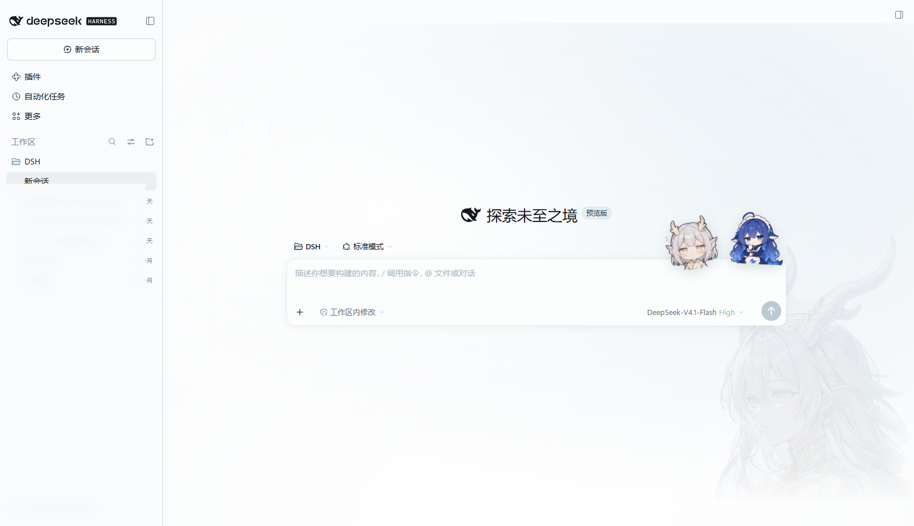
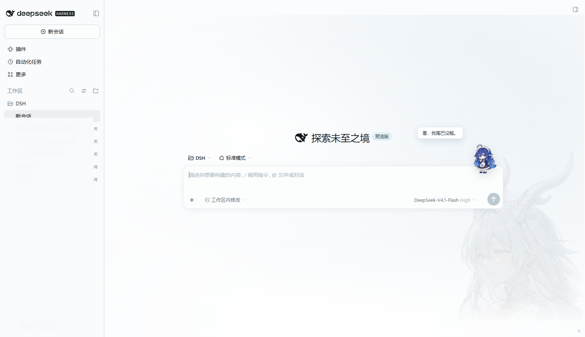

# 云澜 · 白雾 — DSH 主题

给 [DeepSeek Harness](https://www.deepseek.com/harness/) Web UI 的雾蓝皮肤。纯 CSS，不 patch 任何官方文件。




## 它做了什么（对齐 WorkBuddy 白雾）

设计完全照搬 WorkBuddy 的 `.conversation-shell` 思路，不是浮层贴纸：

- **底纹内嵌**：白龙淡底纹 + 四层径向雾气，作为对话区 `[class*="viewArea"]` 的 `background-image`，随 52s 动画流动。不遮挡任何内容、不拦截指针。
- **主色 #5C7E92**：素白 / 雾蓝灰，按钮、焦点、选中态统一走 WorkBuddy 那套色。
- **Q版挂件**：96px 的云澜扒在输入框右上角（`GRgSLq_input` 锚点），bob 呼吸、悬停上窜、长按害羞、点击换表情 + 台词——和 WorkBuddy `#byakuru-mascot` 同一套交互。
- **可切换大肥鱼**：右下角小圆点切换云澜 / 大肥鱼，各 6 张 Q 版表情。状态存 localStorage。
- **明暗跟随**：官方浅色/深色/跟随系统照常有效。


## 双角色动画（v0.4+）

两个 Q 版角色常驻输入框右上角，会根据当前状态自己表演：

| 状态 | 云澜（小龙） | 大肥鱼 |
| --- | --- | --- |
| 闲置 | 打盹 | 捧碗吃白饭 |
| 你在输入 | 凑近注视 | 放下碗偷看 |
| 模型思考中 | 焦急催促「快想想呀！」 | 手忙脚乱 → 害羞 |
| 偶发互动（闲置 14–22s） | 伸手戳大肥鱼 | 惊跳 → 鼓腮「我不是大肥鱼……」 |

故事设定：**大肥鱼总惦记她的白饭，小龙看不下去就去催她**。

状态由 `data-phase` + 停止按钮检测，1.2s 轮询；演出全部是 CSS keyframes + 表情切换，舞台 `pointer-events:none`，输入框不可见时自动隐藏。

## 安装

需要 DSH 桌面端（或 `dsh web`）。插件装进 profile 后重启 DSH。

```bash
# 桌面端
dsh plugin --profile desktop add file:/绝对路径/dsh-yunlan-theme

# 或者浏览器版
dsh plugin --profile web add file:/绝对路径/dsh-yunlan-theme
```

Windows 上 `dsh` 通常不在 PATH，可直接调桌面端内置 CLI：

```bat
"%LOCALAPPDATA%\Programs\DeepSeek Harness\resources\runtime\cli\bin\dsh.cmd" plugin --profile desktop add file:D:\path\to\dsh-yunlan-theme
```

装完**完全退出 DSH 再打开**（插件 bundle 在启动时加载）。

也可以双击 `install.bat`（自动探测 DSH 安装位置）。

## 卸载

```bash
dsh plugin --profile desktop remove dsh-yunlan-theme
```

或双击 `uninstall.bat`。卸载后重启 DSH 即恢复原样，没有残留文件。

## 改配色

全部颜色集中在 `theme.css` 开头两个色阶块里：

| 变量组 | 作用 |
| --- | --- |
| `--dsw-static-neutral-bluish-*` | 界面主体（背景、文字、边框、分隔） |
| `--dsw-static-deepseek-*` | 主色（按钮、焦点、品牌） |
| `--dsw-static-blue-*` | 辅助蓝（链接、选中、信息态） |
| `--dsw-static-neutral-*` | 中性灰（少数组件，已调成同一冷调） |

改完刷新页面（`Ctrl+R`）即可看到，不用重装。颜色是文件实时读取的。

底纹换图：替换 `assets/portrait-corner.webp`（建议透明背景、Alpha 上限 20% 左右）。

## 联名客座：大肥鱼



内置了与社区形象「大肥鱼」的联动，默认关闭，随时切换：

- **切换**：点界面右下角的小圆点。状态存在浏览器 `localStorage`，刷新后保持。
- **交互**：鼠标悬停角色上浮摆尾；点击切一句台词（「我不是大肥鱼……」等 4 句轮换）。
- **互斥**：大肥鱼与云澜共用同一个角色位，同一时间只出现一个；界面配色 token 完全不变。
- **授权**：素材来自 [YunYueSama/codex-deepseek-pet](https://github.com/YunYueSama/codex-deepseek-pet)，按其署名许可使用（允许修改与商用，须署名）。详见 [GUEST-ATTRIBUTION.md](GUEST-ATTRIBUTION.md) 与 [GUEST-LICENSE.txt](GUEST-LICENSE.txt)。`assets/guest/dafeiyu.webp` 经缩放与 WebP 转码，未改动角色内容。

设计动机与完整方案见 `docs/guest-dafeiyu.md`。注意：方案文档基于早期对底层社区角色授权的保守判断，建议拆成独立包；实际取用的素材来自上游作者的署名许可仓库，权限足够，因此最终实现改为内置可切换客座，省去双包安装。

## 实现说明

`index.js`（宿主侧）用 `ctx.webServer.register` 暴露两条路由：

- `/dsh-yunlan/theme.css`
- `/dsh-yunlan/portrait.webp`

`client.js`（浏览器侧）只做一件事：往 `<head>` 插一个 `<link>`。所以样式表是普通 CSS，DevTools 里能直接改、能热刷。

两个实现细节值得记下来：

1. **官方在 `body` 上第二次声明了整套色阶**，且加载在我们之后。只写 `:root` 会被盖掉，必须用 `html body` 抬特异性。
2. **雾层是 `position: fixed` 且在内容之上**，所以强度要克制（角落 alpha ≈ 0.2），中间留空，否则正文对比度会被拉低。

## 兼容性

- 开发验证于 DSH Desktop `0.2.2-rc.5`（Electron 44 / `--dsw-*` token 表 0.2.2-rc.5）
- 依赖 token 命名而非 class 名，所以官方组件改版通常不受影响；token 改名则需要跟着改
- 仅覆盖颜色与装饰，不隐藏、不移动任何功能元素

## License

MIT
