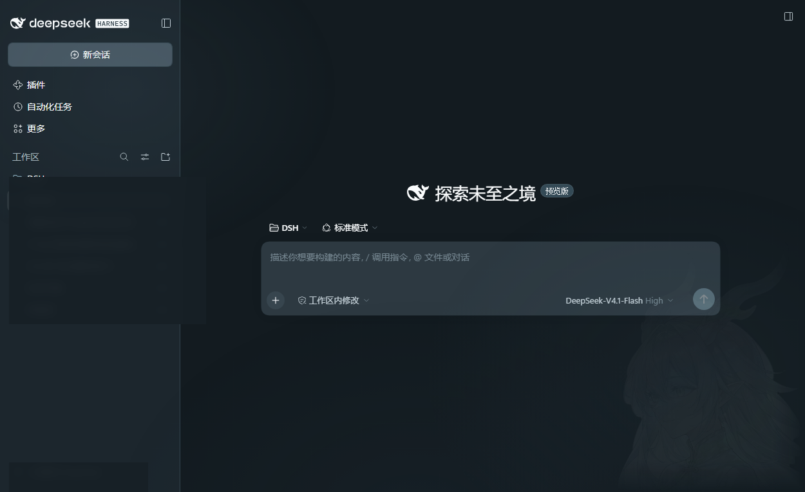

# 云澜 · 白雾 — DSH 主题

给 [DeepSeek Harness](https://www.deepseek.com/harness/) Web UI 的雾蓝皮肤。纯 CSS，不 patch 任何官方文件。




## 它做了什么

- **重写设计 token**：覆盖 82 个 `--dsw-static-*` 色阶，整站配色随之切换。官方别名（`--dsw-alias-*`）继续按语义引用色阶，不用逐条改。
- **表面层次**：画布压成雾白、卡片与输入框留纯白，用明度差代替边框。
- **雾气与龙纹**：`body::before` 四角聚雾、`body::after` 右下角白龙，缓慢漂移，`prefers-reduced-motion` 下静止。
- **明暗跟随**：官方浅色/深色/跟随系统切换照常生效，深色是深岫蓝黑而不是纯黑。

## 安装

需要 DSH 桌面端（或 `dsh web`）。插件装进 profile 后重启 DSH。

```bash
# 桌面端
dsh plugin --profile desktop add file:/绝对路径/dsh-yunlan-theme

# 或者浏览器版
dsh plugin --profile web add file:/绝对路径/dsh-yunlan-theme
```

Windows 上 `dsh` 通常不在 PATH，可直接调桌面端内置 CLI：

```bat
"%LOCALAPPDATA%\Programs\DeepSeek Harness\resources\runtime\cli\bin\dsh.cmd" plugin --profile desktop add file:D:\path\to\dsh-yunlan-theme
```

装完**完全退出 DSH 再打开**（插件 bundle 在启动时加载）。

也可以双击 `install.bat`（自动探测 DSH 安装位置）。

## 卸载

```bash
dsh plugin --profile desktop remove dsh-yunlan-theme
```

或双击 `uninstall.bat`。卸载后重启 DSH 即恢复原样，没有残留文件。

## 改配色

全部颜色集中在 `theme.css` 开头两个色阶块里：

| 变量组 | 作用 |
| --- | --- |
| `--dsw-static-neutral-bluish-*` | 界面主体（背景、文字、边框、分隔） |
| `--dsw-static-deepseek-*` | 主色（按钮、焦点、品牌） |
| `--dsw-static-blue-*` | 辅助蓝（链接、选中、信息态） |
| `--dsw-static-neutral-*` | 中性灰（少数组件，已调成同一冷调） |

改完刷新页面（`Ctrl+R`）即可看到，不用重装。颜色是文件实时读取的。

底纹换图：替换 `assets/portrait-corner.webp`（建议透明背景、Alpha 上限 20% 左右）。

## 实现说明

`index.js`（宿主侧）用 `ctx.webServer.register` 暴露两条路由：

- `/dsh-yunlan/theme.css`
- `/dsh-yunlan/portrait.webp`

`client.js`（浏览器侧）只做一件事：往 `<head>` 插一个 `<link>`。所以样式表是普通 CSS，DevTools 里能直接改、能热刷。

两个实现细节值得记下来：

1. **官方在 `body` 上第二次声明了整套色阶**，且加载在我们之后。只写 `:root` 会被盖掉，必须用 `html body` 抬特异性。
2. **雾层是 `position: fixed` 且在内容之上**，所以强度要克制（角落 alpha ≈ 0.2），中间留空，否则正文对比度会被拉低。

## 兼容性

- 开发验证于 DSH Desktop `0.2.2-rc.5`（Electron 44 / `--dsw-*` token 表 0.2.2-rc.5）
- 依赖 token 命名而非 class 名，所以官方组件改版通常不受影响；token 改名则需要跟着改
- 仅覆盖颜色与装饰，不隐藏、不移动任何功能元素

## License

MIT
