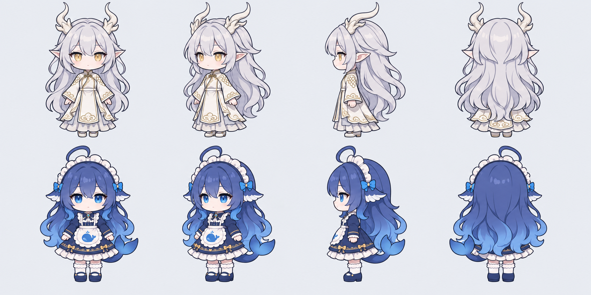
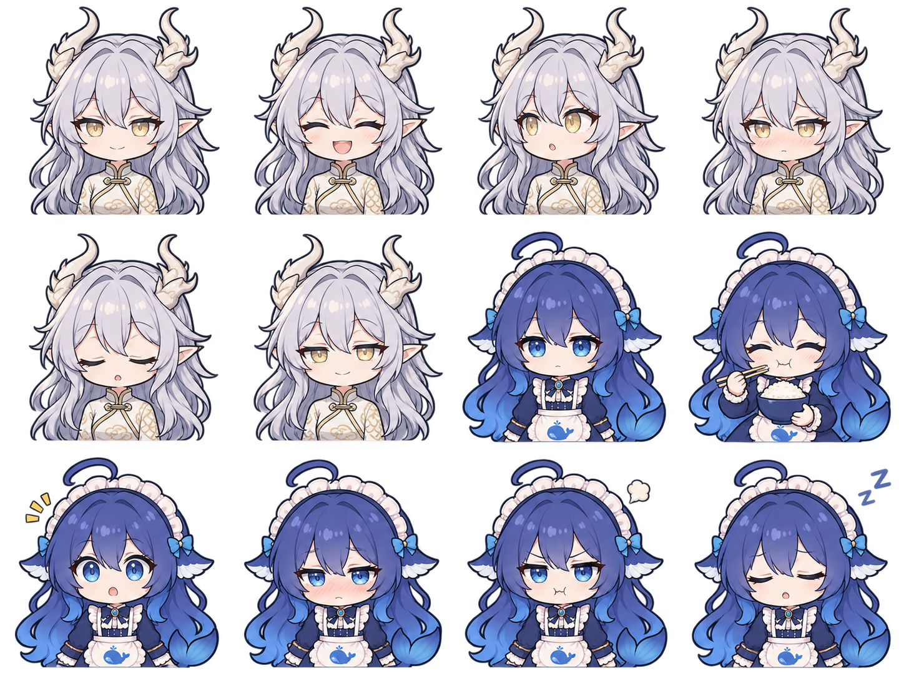

# 云澜与大肥鱼

v0.4.1 的两套 Q 版素材沿用了云澜的原有白龙立绘和大肥鱼的鲸尾女仆设定。两只角色使用相同的头身比、描边和上色方式，便于并排显示。

## 多视图

上排为云澜，下排为大肥鱼。每排从左到右为正面、四分之三侧面、正侧面和背面。

## 表情包

| 行 | 从左到右 |
| --- | --- |
| 第一行 | 云澜微笑、开心、关注、害羞 |
| 第二行 | 云澜打盹、淡笑，大肥鱼普通、吃白饭 |
| 第三行 | 大肥鱼惊讶、害羞、鼓腮、打盹 |

DSH 舞台使用 [assets/q](../../assets/q/) 中的 11 张透明 WebP。云澜的淡笑留在表情图中。大肥鱼的吃白饭表情用作闲置姿势。

大肥鱼参考素材作者为 YunYueSama，来源为其 [codex-deepseek-pet 仓库](https://github.com/YunYueSama/codex-deepseek-pet)。本套图片对 Q 版比例、线条和姿势做了重绘。详见[素材署名](../../GUEST-ATTRIBUTION.md)和[完整许可](../../GUEST-LICENSE.txt)。
